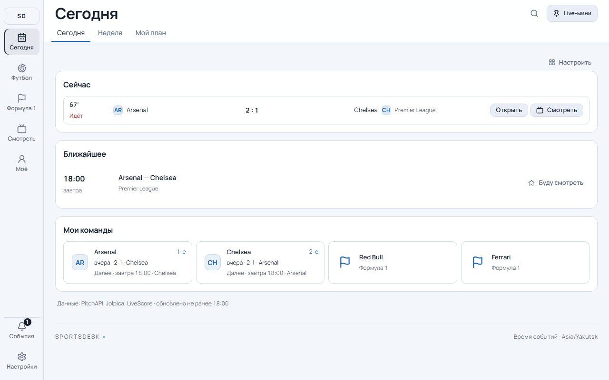
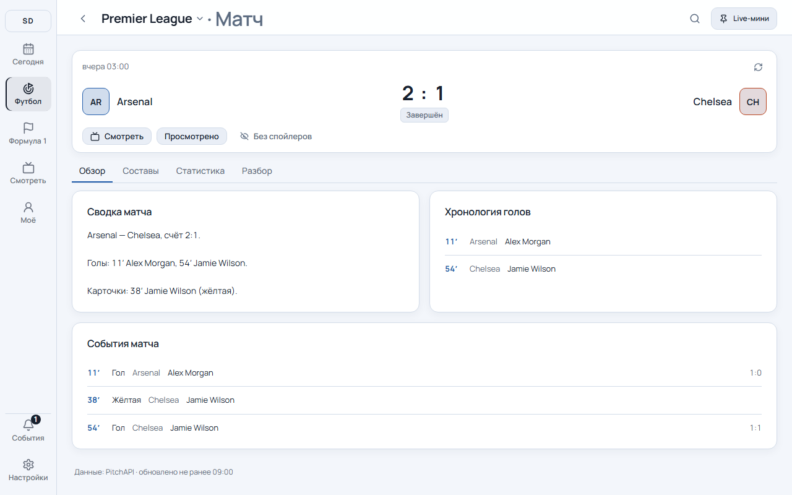
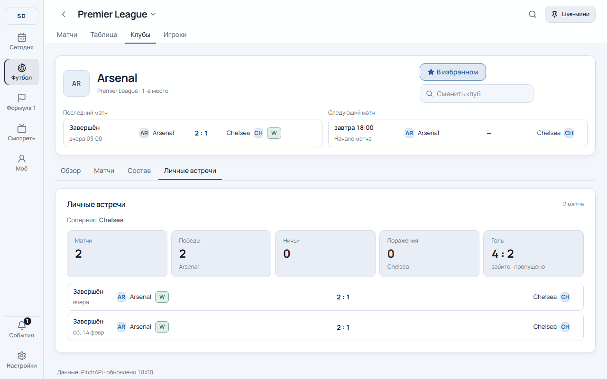
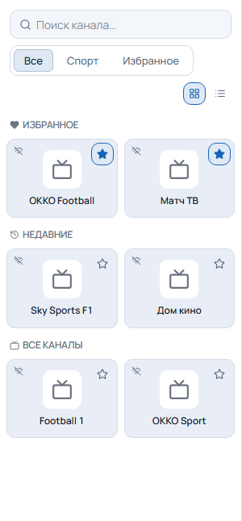

# SportsDesk

Личное приложение для Windows о футболе и Формуле 1: счёт, статистика и каналы, где смотреть.

<picture>
  <source media="(prefers-color-scheme: dark)" srcset="docs/readme/tour-dark.png" />
  
</picture>

Картинки сделаны на тестовых данных.

## Скачать

Свежий установщик и версия без установки — на [странице выпусков](https://github.com/nIzE-666/SportsDesk/releases/latest).

Нужен Microsoft Edge WebView2. Если его нет, установщик предложит поставить среду.

Новые версии появляются на той же странице.

## Что умеет

<details>
<summary><b>Сегодня</b> — идущие и ближайшие матчи, мои команды и личный план.</summary>

<picture>
  <source media="(prefers-color-scheme: dark)" srcset="docs/readme/today-dark.png" />
  
</picture>

</details>

<details>
<summary><b>Матч</b> — счёт, голы, составы, статистика и разбор.</summary>

<picture>
  <source media="(prefers-color-scheme: dark)" srcset="docs/readme/match-dark.png" />
  
</picture>

</details>

<details>
<summary><b>Лига чемпионов</b> — матчи, таблица и сетка; так же открываются кубки.</summary>

<picture>
  <source media="(prefers-color-scheme: dark)" srcset="docs/readme/tournament-dark.png" />
  
</picture>

</details>

<details>
<summary><b>Клуб</b> — обзор, матчи, состав и личные встречи.</summary>

<picture>
  <source media="(prefers-color-scheme: dark)" srcset="docs/readme/club-dark.png" />
  
</picture>

</details>

<details>
<summary><b>Формула 1</b> — ближайший уикенд, последняя гонка и избранные пилоты.</summary>

<picture>
  <source media="(prefers-color-scheme: dark)" srcset="docs/readme/f1-dark.png" />
  
</picture>

</details>

<details>
<summary><b>Смотреть</b> — избранные, недавние и все каналы.</summary>

<picture>
  <source media="(prefers-color-scheme: dark)" srcset="docs/readme/watch-dark.png" />
  
</picture>

</details>

<details>
<summary><b>Моё</b> — избранное, дневник, прогнозы и схемы.</summary>

<picture>
  <source media="(prefers-color-scheme: dark)" srcset="docs/readme/my-dark.png" />
  
</picture>

</details>

## Что нового в 2.0

- Пять разделов в узкой панели: «Сегодня», «Футбол», «Формула 1», «Смотреть» и «Моё», события — в панели по колокольчику.
- Экран «Сегодня»: «Сейчас», «Ближайшее» и «Мои команды» на одном экране.
- Лига чемпионов и кубки — внутри «Футбола», на одном экране турнира.
- «Моё» собрало избранное, дневник, прогнозы и схемы.
- Живые матчи приходят из основного источника, при сбое — из запасного.
- Одно оформление с общими цветами и элементами в светлой и тёмной темах.
- В матче четыре вкладки: «Обзор», «Составы», «Статистика» и «Разбор».
- «Матчи» — один список по дням с фильтрами «Мои · Все · Сейчас идут».
- У клуба вкладки «Обзор · Матчи · Состав · Личные встречи», в «Игроках» — поиск и сравнение.
- «Формула 1» начинается с обзора уикенда, последней гонки и избранных пилотов.
- «Смотреть»: избранные, недавние и все каналы собраны вместе.
- Настройки разложены по категориям, длинные части свёрнуты, лишнее отключается в «Модулях».

## Первый запуск

1. Запустите SportsDesk. Мастер настройки проведёт по шагам: лига и клубы, Формула 1, модули, часовой пояс, уведомления, тема, источники. Любой шаг можно пропустить — всё меняется позже в «Настройках».
2. Откройте «Настройки → Просмотр».
3. Заполните данные клиента: «Адрес API (https://…)», «Client ID» и «Client secret». Нажмите «Сохранить настройки KinoPub».
4. Нажмите «Войти по коду устройства» — программа покажет код.
5. Нажмите «Открыть страницу авторизации» и введите код на открывшейся странице. После подтверждения каналы появятся в «Смотреть».

## Ограничения

- Полнота данных зависит от источника: неизвестное значение показывается прочерком.
- Статистика игрока собирается по завершённым матчам его клуба в загруженном сезоне, а не по всей карьере.
- Таблицы турниров относятся к текущему сезону; архивную таблицу приложение не показывает.
- Сравнение пилотов складывает очки гонок и спринтов; опубликованный зачёт показан отдельно.
- «Темп» сравнивает время кругов, а не отрыв на трассе; поправок на трафик, машину безопасности, топливо и шины нет.
- Время окончания в личном плане оценивается: дополнительное время, переносы и красные флаги могут менять пересечения.

<details>
<summary><b>Для разработки</b></summary>

Стек: React 19, TypeScript, Vite, Tauri 2 / Rust, SQLite.

Для разработки и тестов нужен Node.js 22.12+ в ветке 22, Node.js 24 или Node.js 26 и новее (требование Vitest 5).

- `npm install` — зависимости.
- `npm run dev` — локальный интерфейс и мост реальных API, http://127.0.0.1:1420.
- `npm test` — тесты.
- `npm run build` — строгие типы и frontend.
- `npm run tauri:dev` — desktop-разработка.
- `npm run tauri:build` — Windows EXE и NSIS-установщик. Нужны Rust MSVC, Visual Studio Build Tools и Windows SDK.
- `cargo test --manifest-path src-tauri/Cargo.toml --lib` — нативные проверки.
- `npm run typecheck` — типы приложения.
- `npm run lint` — ESLint.
- `npm run format:check` — Prettier.
- `npm run typecheck:e2e` — типы Playwright-сценариев.
- `npx playwright install chromium` — браузер для визуальных тестов после установки npm-зависимостей.
- `npm run test:e2e` — все браузерные сценарии.
- `npm run test:visual` — сравнить 34 эталонных снимка в пяти наборах (`visual`, `matchAnalysis`, `tactics`, `diary`, `offline`). Фиксированные ответы и время, отдельный dev-сервер на 1421 (другой порт задаёт `SPORTSDESK_E2E_PORT`). Личный сервер на 1420 и внешние API не используются. Эталоны сняты в Windows Chromium; для другой ОС нужны отдельные эталоны или тот же Windows runner.
- `npm run test:visual:update` — обновить эталоны после намеренных визуальных изменений; полученные PNG нужно просмотреть перед коммитом.

`npm run test:visual` запускает 28 сценариев; 34 снимка — это файлы в `e2e/*-snapshots/`.

`src/` содержит интерфейс и адаптеры данных, `dev/` — локальный мост для браузерной проверки, `src-tauri/` — нативную часть и команды приложения. Ключи и вход в каналы не должны попадать в исходники, журналы или установщик.

Чтобы пересобрать картинки README:

```bash
SPORTSDESK_README_OUTPUT=docs/readme npx playwright test e2e/readmeShots.pw.ts
node scripts/readmeTour.mjs
```

Без `SPORTSDESK_README_OUTPUT` сценарий пропускается. Первая команда пишет 14 снимков в `docs/readme`, вторая собирает два обзора по шести экранам.

</details>

<details>
<summary><b>Источники данных и лицензии</b></summary>

- PitchAPI — расписание, матчи, составы, события, статистика и игроки.
- SportScore — счёт, события, составы и таблицы. Ссылка «Powered by SportScore» ведёт на [sportscore.com](https://sportscore.com).
- Jolpica — расписание, результаты, квалификация и зачёты Формулы 1.
- OpenF1 — исторические данные с 2023 года: круги, пит-стопы и погода. Живой телеметрии в бесплатном доступе нет.
- LiveScore и ESPN — неофициальные бесплатные источники живых матчей.
- Kino — трансляции после входа по коду устройства.

Протокол KinoWatch изучен по MIT-проекту; подробности — в [THIRD_PARTY_NOTICES.md](THIRD_PARTY_NOTICES.md).

Приложение не является официальным продуктом лиг или команд.

</details>

<details>
<summary><b>История версий</b></summary>

Все выпуски, проверки и прежнее описание — в [CHANGELOG.md](CHANGELOG.md).

</details>
