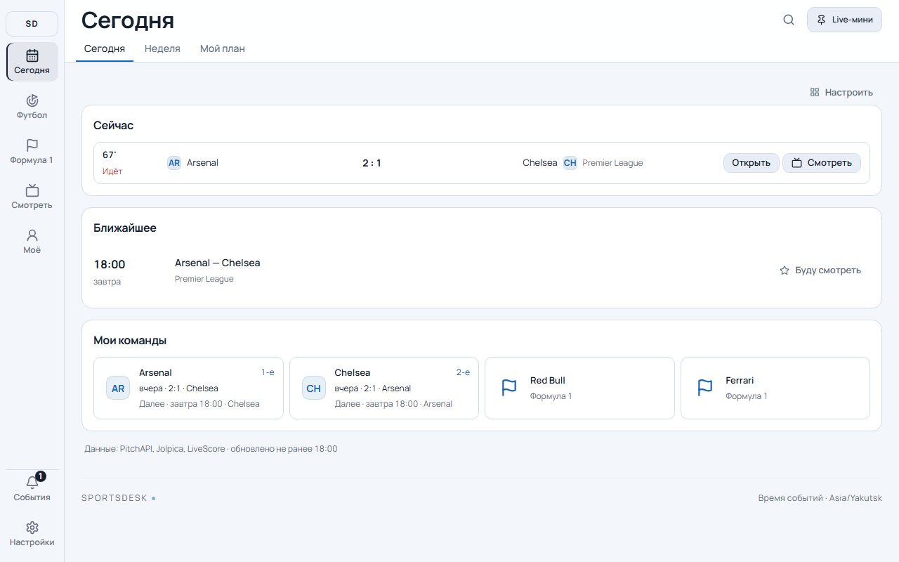
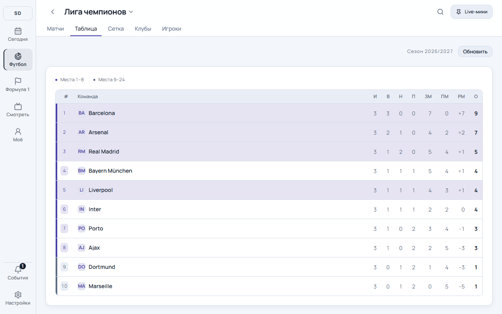
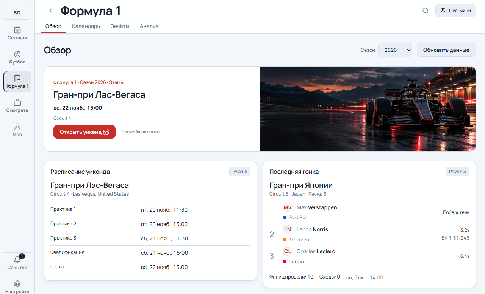
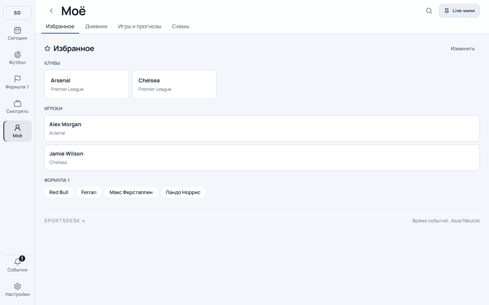

# SportsDesk

**Настольный центр спортивной аналитики, расписания и трансляций для Windows: футбол, Формула 1 и спортивные ТВ-каналы в одном быстром приложении.**

> **English summary:** Fast native Windows desktop hub (**Tauri 2 / Rust + React 19 / TypeScript + SQLite**) for football & Formula 1 analytics, live scores, lineups, match statistics, standings, F1 race weekends/lap pace, spoiler-free mode, personal match planner & tactical board, and integrated HLS TV streaming. Ready-to-run installer & portable EXE in [Releases](https://github.com/nIzE-666/SportsDesk/releases/latest).

<p align="center">
  <a href="https://github.com/nIzE-666/SportsDesk/releases/latest"></a>
  
  
  
  <a href="https://github.com/nIzE-666/SportsDesk/actions/workflows/ci.yml"></a>
</p>

<picture>
  <source media="(prefers-color-scheme: dark)" srcset="docs/readme/tour-dark.png" />
  
</picture>

<sub>Светлая и тёмная темы переключаются автоматически под тему GitHub. Скриншоты сделаны на тестовых данных.</sub>

---

## Скачать и запустить (Windows)

Готовый установщик (`SportsDesk_*_x64-setup.exe`) и портативная версия без установки (`SportsDesk_*_portable.exe`) доступны на странице выпусков:

👉 **[Скачать последний релиз SportsDesk](https://github.com/nIzE-666/SportsDesk/releases/latest)**

- **Требования:** Windows 10 / 11 (x64) и Microsoft Edge WebView2 (если не установлен, инсталлятор поставит его автоматически).
- **Быстрый старт:** при первом запуске откроется мастер настройки — выберите любимые лиги, клубы, пилотов Формулы 1, часовой пояс, тему и модули. Любой шаг можно пропустить и изменить позже в «Настройках».
- **Приватность:** настройки, локальный кеш и история хранятся в SQLite на вашем ПК; ключи провайдеров защищены через Windows DPAPI и не попадают в бэкапы и логи.

---

## Ключевые возможности

| Раздел | Что внутри |
|---|---|
| **Сегодня** | Текущие live-матчи (с автоматическим резервным источником), ближайшие игры, расписание на неделю, избранные команды и личный план на вечер |
| **Футбол и аналитика матча** | Счёт, хронология голов и событий, составы и расстановка, xG и расширенная статистика, разбор матча, страницы клубов (обзор, состав, личные встречи `W–D–L`), поиск и сравнение игроков |
| **Турниры и кубки** | Топ-лиги, Лига чемпионов и кубковые турниры: таблицы, сетка плей-офф, календарь и экспорт расписания (`.ics`) |
| **Формула 1** | Обзор ближайшего уикенда с расписанием всех сессий, последняя гонка, зачёты пилотов и конструкторов, сравнение пилотов, круги, темп, пит-стопы и погода (Jolpica + OpenF1) |
| **Смотреть (ТВ)** | Встроенный HLS-плеер и каталог спортивных каналов (избранные, недавние, поиск), подключение через код устройства |
| **Моё** | Избранное, дневник просмотров, прогнозы, интерактивная тактическая доска, офлайн-библиотека сезонов и **режим без спойлеров** |
| **Комфорт** | Светлая и тёмная темы, системный трей с ближайшими событиями, уведомления о голах и начале матчей (с тихими часами), глобальный поиск (`Ctrl+K`), окно Live-мини (`Ctrl+Shift+L`), резервные копии с контрольной суммой |

---

## Галерея экранов

<details open>
<summary><b>Сегодня</b> — идущие и ближайшие матчи, мои команды и личный план</summary>

<picture>
  <source media="(prefers-color-scheme: dark)" srcset="docs/readme/today-dark.png" />
  
</picture>

</details>

<details>
<summary><b>Матч</b> — счёт, голы, составы, статистика и разбор</summary>

<picture>
  <source media="(prefers-color-scheme: dark)" srcset="docs/readme/match-dark.png" />
  
</picture>

</details>

<details>
<summary><b>Лига чемпионов и кубки</b> — матчи, таблица и сетка</summary>

<picture>
  <source media="(prefers-color-scheme: dark)" srcset="docs/readme/tournament-dark.png" />
  
</picture>

</details>

<details>
<summary><b>Клуб</b> — обзор, матчи, состав и личные встречи</summary>

<picture>
  <source media="(prefers-color-scheme: dark)" srcset="docs/readme/club-dark.png" />
  
</picture>

</details>

<details>
<summary><b>Формула 1</b> — ближайший уикенд, последняя гонка и избранные пилоты</summary>

<picture>
  <source media="(prefers-color-scheme: dark)" srcset="docs/readme/f1-dark.png" />
  
</picture>

</details>

<details>
<summary><b>Смотреть</b> — избранные, недавние и все спортивные каналы</summary>

<picture>
  <source media="(prefers-color-scheme: dark)" srcset="docs/readme/watch-dark.png" />
  
</picture>

</details>

<details>
<summary><b>Моё</b> — избранное, дневник, прогнозы и тактические схемы</summary>

<picture>
  <source media="(prefers-color-scheme: dark)" srcset="docs/readme/my-dark.png" />
  
</picture>

</details>

---

## Что нового в версии 2.0

- Пять основных разделов в компактной навигации: **«Сегодня»**, **«Футбол»**, **«Формула 1»**, **«Смотреть»** и **«Моё»**; центр событий вынесен на колокольчик.
- Единая дизайн-система со светлой и тёмной темами и токенами компонентов.
- Автоматический резервный источник живых матчей при недоступности основного.
- Упрощённая карточка матча с четырьмя вкладками: **«Обзор»**, **«Составы»**, **«Статистика»** и **«Разбор»**.
- Общий список матчей по дням с быстрыми фильтрами **«Мои · Все · Сейчас идут»**.
- Переработанная страница клуба (**«Обзор · Матчи · Состав · Личные встречи»**) и сравнение игроков.
- Модульные настройки — неиспользуемые разделы можно скрывать в «Модулях».

---

## Подключение ТВ-каналов (опционально)

1. Откройте **«Настройки → Просмотр»**.
2. Заполните параметры клиента: **«Адрес API (`https://…`)»**, **«Client ID»** и **«Client secret»**, затем нажмите **«Сохранить настройки KinoPub»**.
3. Нажмите **«Войти по коду устройства»** — приложение покажет короткий код.
4. Перейдите по кнопке **«Открыть страницу авторизации»** и подтвердите код — каналы автоматически появятся в разделе **«Смотреть»**.

---

## Известные ограничения

- Полнота отдельных метрик зависит от источника: отсутствующее значение отображается прочерком.
- Статистика футболиста рассчитывается по завершённым матчам его клуба в загруженном сезоне.
- Таблицы турниров относятся к текущему сезону (исторические сезоны доступны в офлайн-библиотеке матчей).
- В сравнении пилотов F1 суммируются очки гонок и спринтов; официальный зачёт показан отдельно.
- График «Темп» сравнивает чистое время кругов без поправки на трафик, машину безопасности, топливо и шины.
- Оценка времени окончания в личном плане ориентировочная — овертаймы, переносы и красные флаги могут сдвигать расписание.

---

<details>
<summary><b>Сборка из исходников и разработка</b></summary>

**Стек:** React 19, TypeScript, Vite, Tauri 2 / Rust, SQLite, Playwright, Vitest.

Для разработки и запуска тестов нужен **Node.js 22.12+ / 24 / 26+** (требование Vitest 5). Для нативной сборки Windows EXE / NSIS-установщика также требуются Rust MSVC, Visual Studio Build Tools и Windows SDK.

```bash
npm install                                           # зависимости
npm run dev                                           # локальный UI + dev-мост (http://127.0.0.1:1420)
npm test                                              # unit-тесты (Vitest)
npm run build                                         # проверка типов + production frontend
npm run tauri:dev                                     # запуск desktop-приложения в dev-режиме
npm run tauri:build                                   # сборка Windows EXE и NSIS-установщика
cargo test --manifest-path src-tauri/Cargo.toml --lib # Rust-тесты
```

Дополнительные проверки:
- `npm run typecheck`, `npm run lint`, `npm run format:check`, `npm run typecheck:e2e`
- `npx playwright install chromium` → `npm run test:e2e` и `npm run test:visual` (28 сценариев / 34 эталонных снимка).
- Пересборка скриншотов README:
  ```bash
  SPORTSDESK_README_OUTPUT=docs/readme npx playwright test e2e/readmeShots.pw.ts
  node scripts/readmeTour.mjs
  ```

Структура: `src/` — интерфейс и адаптеры данных, `dev/` — локальный мост для браузерной отладки, `src-tauri/` — нативный backend на Rust, SQLite и системные команды.

</details>

<details>
<summary><b>Источники данных и лицензии</b></summary>

- **PitchAPI** — расписание, матчи, составы, события, статистика и игроки.
- **SportScore** — счёт, события, составы и таблицы ([sportscore.com](https://sportscore.com)).
- **Jolpica** — расписание, результаты, квалификация и зачёты Формулы 1.
- **OpenF1** — исторические данные с 2023 года: круги, пит-стопы и погода.
- **LiveScore и ESPN** — бесплатные источники живых матчей.
- **Kino** — ТВ-трансляции после авторизации по коду устройства (подробности заимствования протокола KinoWatch — в [THIRD_PARTY_NOTICES.md](THIRD_PARTY_NOTICES.md)).

Приложение является независимым проектом и не аффилировано с футбольными лигами, клубами, Formula 1 или сторонними видеосервисами.

</details>

<details>
<summary><b>История версий</b></summary>

Полная история релизов, изменений и проверок — в [CHANGELOG.md](CHANGELOG.md).

</details>
